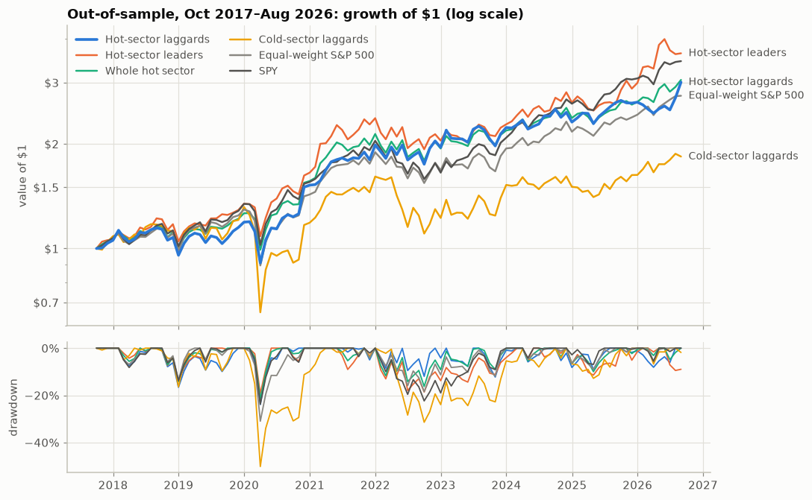
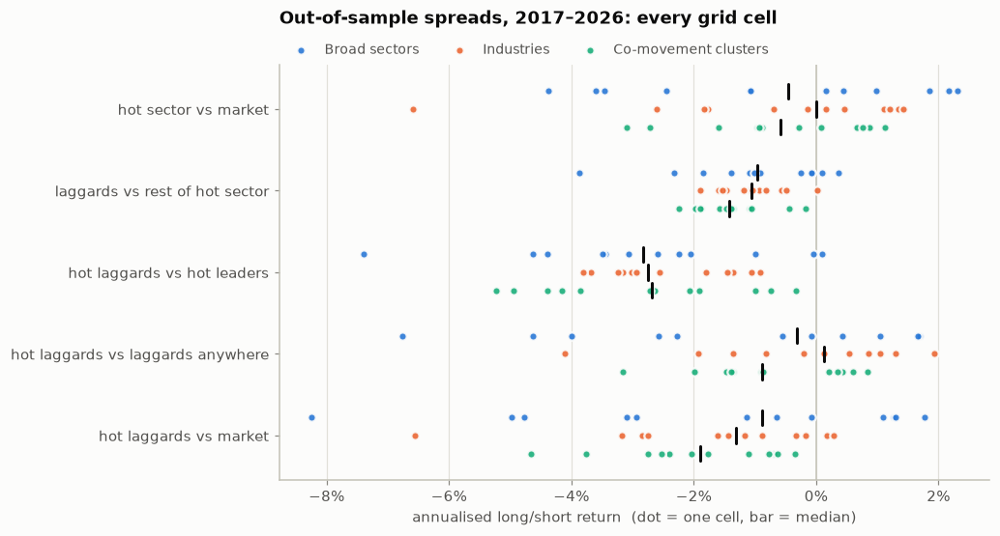
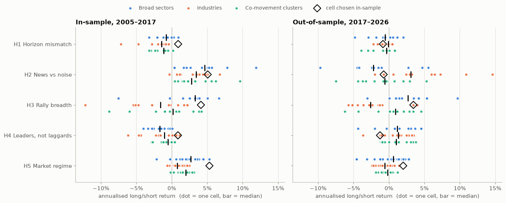
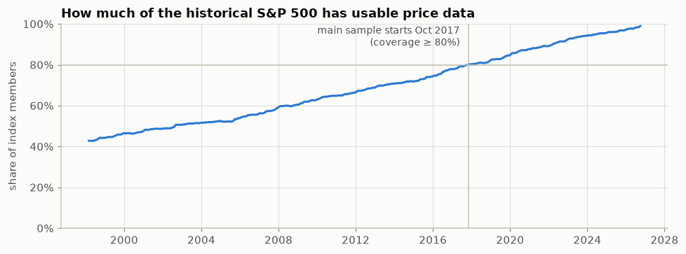

# under-stocks-over-markets

A backtest of one stock-picking idea: **among S&P 500 stocks, find the sectors that are running
hot and buy the weakest stocks inside them**, betting that the laggards of a strong group catch
up with it.

The analysis, with every chart, is in [`notebooks/analysis.ipynb`](notebooks/analysis.ipynb). Five
attempts to fix the idea are tested in [`notebooks/hypotheses.ipynb`](notebooks/hypotheses.ipynb).

## Result



*The setting that did best in 2005–2017 (broad sectors, 6-month lookback, 3-month hold), run on
2017–2026. The laggards made 13.1%/yr, against 12.0% for the equal-weight index, 14.9% for SPY and 15.6%
for the leaders they passed over.*

**The idea doesn't hold up.** Out-of-sample (Oct 2017 – Aug 2026, the years where ≥80% of point-in-time
index members have usable prices), after 10 bp costs:

- **Against the market:** hot-sector laggards trailed the equal-weight S&P 500 by a median 1.3%/yr
  across the 36 lookback × holding × sector-definition cells. 30 cells were negative, and none was
  significantly positive.
- **Leaders vs laggards:** inside hot sectors, the leaders beat the laggards (median 2.7%/yr, in 35 of
  36 cells).
- **Catching up:** the laggards beat their own sector's return over the holding period only 47–50% of
  the time.
- **The memory example:** in the 20 months since 2023 when Micron's cluster was hot, the laggards
  returned +11% over the next 3 months, against +31% for the leaders.
- **Earlier years:** the idea looked mildly positive in 2005–2017. That's the stretch where many failed
  companies are missing from the data, a bias that flatters buying losers.



*Every out-of-sample cell (4 lookbacks × 3 holding periods × 3 sector definitions), net of costs. Dot =
one cell, bar = median. "Hot laggards vs market" is below zero in 30 of 36 cells, "hot laggards vs hot
leaders" in 35.*

## Five attempts to fix it

Each fix is grounded in published research and tested the same way. The best setting is chosen on
2005–2017 alone, then that single setting is tested on 2017–2026 with a Holm correction for trying five
ideas.

| | Change | In-sample | Out-of-sample |
|---|---|---|---|
| H1 | rank groups on 3–12 months, laggards on 1 month (industry momentum vs. within-industry reversal) | fails | −0.8%/yr |
| H2 | skip laggards that fell on news (a jump in stock-specific volatility) | passes | −0.7%/yr |
| H3 | only laggards from broad-based rallies | fails | +3.5%/yr, not significant |
| H4 | hot-group leaders instead of plain stock momentum | fails | −1.3%/yr |
| H5 | laggards in volatile markets, leaders otherwise | passes | +2.0%/yr, not significant |



*Each dot is one cell of a hypothesis's family; diamonds mark the cells chosen in-sample. A real effect
would sit right of zero in both panels. H2 and H5 do in-sample, then straddle zero out-of-sample.*

**None is confirmed.** A blend of the two that passed in-sample made 13.7%/yr out-of-sample, against
12.0% for the equal-weight index (t = 0.7). That's still behind hot-sector leaders (15.6%) and SPY (14.9%).

Two things held in both periods:
- Laggards that fell on news trailed the index (−2.9% and −2.2%/yr).
- After a falling year, laggards beat leaders inside hot groups, though on few months.

Neither turns laggard-buying into an edge. No laggard sub-basket beat the index in either period.

## What it does

- **Universe.** S&P 500 with point-in-time membership (each month uses that month's members) from
  the public [`fja05680/sp500`](https://github.com/fja05680/sp500) dataset. Daily prices come from Yahoo
  via `yfinance`.
- **Three definitions of "sector":** Yahoo's 11 sectors, Yahoo's ~145 industries, and clusters of
  stocks that traded together over the past year (re-formed monthly from past data only).
- **Grid:** lookbacks of 1/3/6/12 months × holding periods of 1/3/6 months, monthly overlapping
  portfolios, equal weights, 10 bp one-way costs, execution the trading day after each signal.
- **Baselines** that could explain any result: hot-sector leaders, the whole hot sector, cold-sector
  laggards, laggards in every sector or in the whole index, the equal-weight index, and SPY.
- **Robustness:** parameters chosen on the early years and tested on the later ones, the full grid
  always shown, Newey–West t-stats, factor regressions (Fama–French 5 + momentum + short-term
  reversal), and a cost sweep.

Every data source is free and needs no API key: GitHub raw files, Yahoo, and the Ken French Data Library.

## Run it

```sh
uv sync
uv run python -m usom.pipeline          # downloads and caches data, runs the grid (~10 min the first time)
uv run python -m usom.experiments       # the five hypotheses (~8 min)
uv run jupyter lab notebooks/
```

Downloads are cached under `data/` (git-ignored), so reruns are fast. To re-execute the notebook
headless:

```sh
uv run jupyter nbconvert --to notebook --execute --inplace notebooks/*.ipynb
```

Checks:

```sh
uv run ruff format --check . && uv run ruff check . && uv run pytest -q
```

## Layout

| Path | Role |
|---|---|
| `src/usom/universe.py` | point-in-time membership, ticker normalization |
| `src/usom/prices.py` | Yahoo price cache, bad-tick filter, trusted-spell and coverage checks |
| `src/usom/classify.py` | Yahoo sector and industry labels (cached) |
| `src/usom/factors.py` | Ken French factors and T-bill rate |
| `src/usom/groups.py` | the three grouping schemes |
| `src/usom/signals.py` | hot and cold groups, laggards and leaders → baskets |
| `src/usom/backtest.py` | overlapping-portfolio engine, costs, per-pick outcomes |
| `src/usom/metrics.py`, `analysis.py` | statistics and result tables |
| `src/usom/plots.py` | charts |
| `src/usom/pipeline.py` | end-to-end run that writes `data/results/*.parquet` |
| `src/usom/features.py` | point-in-time market state, abnormal volatility, group breadth |
| `src/usom/experiments.py` | the five hypotheses, pre-registered scoring, Holm correction |
| `tests/` | synthetic-data tests, including a no-lookahead check |
| `docs/figures/` | charts used in this README, exported from the executed notebooks |

## Limitations

- **Survivorship bias.** Yahoo has no history for most delisted companies. Coverage of point-in-time members is
  under 60% before 2008 and only passes 80% in late 2017, so the main results start in October 2017 and
  the earlier years are only used to choose parameters. Stocks that stop trading are held as cash at their
  last quote (no delisting returns).

  

- **Labels from today.** Yahoo's sector and industry labels are current ones, applied to the past. The
  co-movement clusters don't have this problem.
- **Large caps, US only.** Samsung and SK Hynix aren't in the universe.
- This is research, not investment advice.
